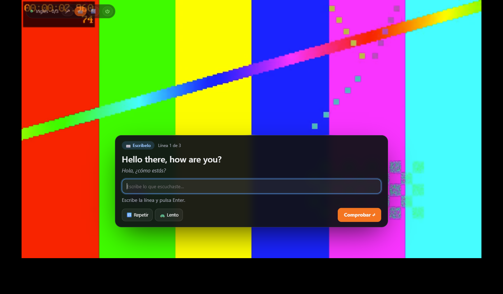
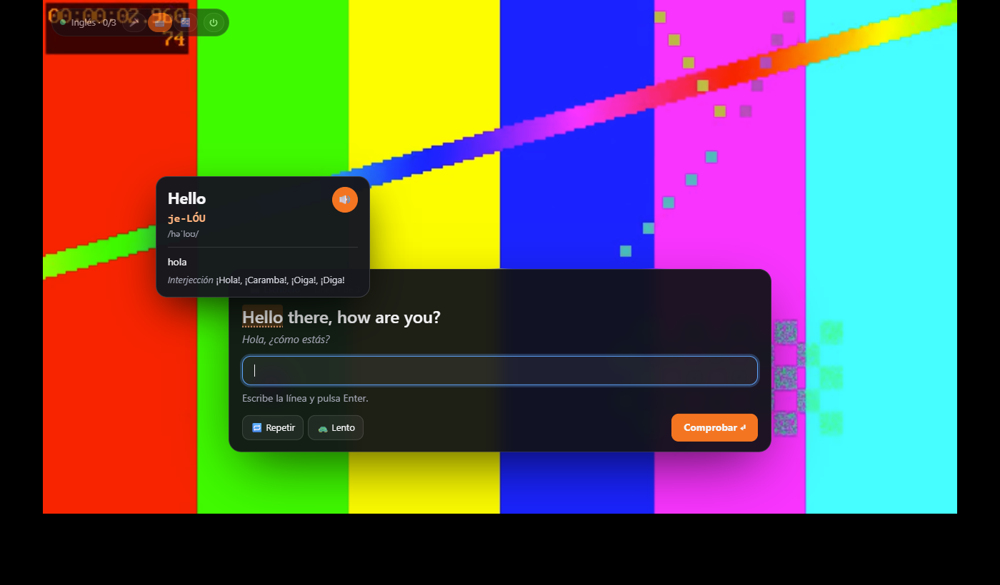
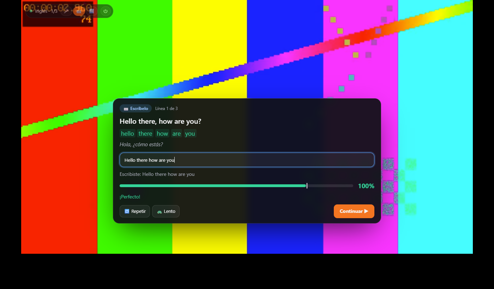
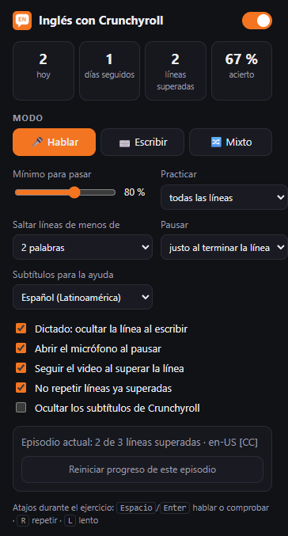

# Inglés con Crunchyroll y YouTube · enzo

**Practica inglés con las frases del episodio: escucha, comprende, escríbelas o repítelas y sigue cuando superes el ejercicio.**

Extensión Manifest V3 para escritorio, con interfaz en español, proyecto sin compilación y ejercicios integrados sobre el reproductor. Versión **1.3.0**.

> [!IMPORTANT]
> Proyecto independiente y experimental, no afiliado a Crunchyroll ni a YouTube. Necesita acceso legítimo al contenido. No descarga episodios, no evita suscripciones y no modifica el DRM. La puntuación compara texto reconocido o escrito: **no es una evaluación fonética profesional**.

## Contenido

- [Funciones](#funciones)
- [Capturas](#capturas)
- [Instalación](#instalación)
- [Cómo practicar](#cómo-practicar)
- [Ajustes y atajos](#ajustes-y-atajos)
- [Puntuación y pronunciación](#puntuación-y-pronunciación)
- [Privacidad y permisos](#privacidad-y-permisos)
- [Desarrollo y pruebas](#desarrollo-y-pruebas)
- [Publicación segura](#publicación-segura)
- [Límites y solución de problemas](#límites-y-solución-de-problemas)
- [Procedencia y licencias](#procedencia-y-licencias)

## Funciones

| Función | Comportamiento |
| --- | --- |
| 🎤 Hablar | Muestra la frase, reconoce tu voz en inglés y colorea las palabras según la coincidencia. |
| ⌨️ Escribir | Deja visible la frase para copiarla y comprueba tu respuesta con Enter. |
| 🔀 Mixto | Alterna ejercicios de voz y escritura. |
| Traducción completa | El significado de **toda la frase** aparece debajo del inglés, sin tener que pulsar un botón. |
| Cómo se dice | Entre el inglés y la traducción aparece una guía aproximada para hispanohablantes, en azul, generada con diccionarios locales. Las palabras sin datos quedan entre corchetes. En dictado se oculta hasta revelar la respuesta. |
| Diccionario por palabra | Al pasar el ratón o hacer clic: significado en español, guía de pronunciación para hispanohablantes, AFI cuando está disponible y audio. |
| Cambio inmediato | Cambiar el modo arriba o en el popup actualiza la frase abierta sin pasar a otra. |
| Práctica obligatoria | No existe botón ni atajo «Saltar». Play, clic fuera o mover la barra no liberan un ejercicio pendiente. |
| Repetición | Reproduce el fragmento actual a velocidad normal o reducida; vuelve al mismo ejercicio. |
| Progreso local | Guarda frases aprobadas por episodio, intentos, aciertos y racha de días. |
| Subtítulos propios | Permite cargar archivos ASS/SSA, VTT o SRT como alternativa a la detección automática. |

La pausa se calcula a partir del tiempo del subtítulo seleccionado, teniendo en cuenta solapamientos y un ajuste opcional. **El final del subtítulo no siempre coincide con el instante en que termina de hablar el personaje.**

## Capturas

Capturas reales de la extensión en un **reproductor de prueba con video sintético y frases inventadas**. No contienen episodios, cuentas, datos de sesiones ni imágenes del usuario.

<table>
<tr>
<td width="50%"><strong>Frase y significado completo</strong><br></td>
<td width="50%"><strong>Ayuda palabra por palabra</strong><br></td>
</tr>
<tr>
<td><strong>Respuesta aprobada</strong><br></td>
<td><strong>Opciones y estadísticas</strong><br></td>
</tr>
</table>

## Instalación

No hace falta Node.js, Python ni un servidor para **usar** la extensión: los diccionarios ya están incluidos.

1. Descarga el repositorio con **Code → Download ZIP** y descomprímelo. También puedes clonarlo:

   ```bash
   git clone https://github.com/EnzoCodeDev/extension-crunchyroll.git
   ```

2. Abre `edge://extensions` en Microsoft Edge o `chrome://extensions` en Google Chrome.
3. Activa **Modo para desarrolladores**.
4. Pulsa **Carga desempaquetada / Cargar descomprimida** y selecciona la carpeta que contiene `manifest.json`.
5. Abre o recarga un episodio de Crunchyroll o un video de YouTube con subtítulos en inglés en el navegador.
6. Aparecerá una píldora de estado sobre el video con el modo y el progreso.
7. Para hablar, permite el micrófono cuando lo solicite el navegador. Espera a ver **«Escuchando…»** antes de decir la frase.

Para actualizar una copia instalada, actualiza sus archivos, pulsa **Volver a cargar** en la tarjeta de la extensión y recarga la pestaña del episodio.

> [!NOTE]
> La prueba automatizada se ejecuta en Chrome de escritorio. Se ha cargado también en Edge de escritorio. La disponibilidad real del reconocimiento y de las voces depende del navegador, su configuración y el sistema; no se garantiza en Firefox, Brave ni navegadores móviles.

## Cómo practicar

### 1. Escucha el fragmento

Elige un episodio y tu modo. Para dictado, conviene audio en inglés y una pista de subtítulos de diálogo que corresponda al doblaje. Si hay `English [CC]`, la extensión intenta priorizarla para audio en inglés; si falta, usa una pista inglesa disponible, que puede no coincidir literalmente.

Con audio japonés, la frase inglesa puede ser una traducción del original: sirve para leer y practicar inglés, pero no es lo que se está pronunciando en el video.

### 2. Lee la frase y su significado

Al finalizar la línea seleccionada, el video se pausa y aparece el ejercicio. **La traducción de la frase completa se muestra automáticamente**:

- Primero se reúnen las líneas españolas que se solapan con la frase inglesa. Si cubren menos del 80 % de su intervalo temporal, se pide la traducción automática de la frase completa en lugar de mostrar solo un fragmento.
- Si no se encuentra una traducción oficial suficientemente alineada, se solicita una traducción automática de la frase inglesa.
- Mientras llega la traducción se muestra «Traduciendo…». Si falla, se muestra el aviso; no se inventa un resultado ni se bloquea la escritura.

### 3. Consulta una palabra

Pasa el ratón por una palabra de la frase, de lo escrito o del texto reconocido. El recuadro muestra, cuando hay datos:

- Significado en español y otros sentidos gramaticales.
- Pronunciación aproximada con letras para un hispanohablante: **`je-LÓU`**, **`ad-VÉN-cher`**.
- AFI, por ejemplo **`/həˈloʊ/`**.
- Botón 🔊 para escucharla con una voz inglesa del navegador.

Un clic fija el recuadro. Hacer clic fuera lo cierra, **sin saltar el ejercicio**.

### 4. Habla o escribe

- **Hablar:** pulsa 🎤 si no se ha abierto el micrófono, di la frase completa y espera el resultado. Puedes detener la escucha con el mismo botón.
- **Escribir:** copia la frase visible y pulsa Enter. En **Dictado** se oculta el texto; puedes repetir el audio, pedir las primeras letras y después ver la respuesta.
- **Mixto:** alterna el tipo de ejercicio. Si necesitas otro modo, cámbialo arriba: se actualiza la frase actual, no se pasa a otra.

Repetir y Lento vuelven al fragmento y después regresan al mismo ejercicio. Si el navegador rechaza la reproducción, el panel muestra un aviso y permite reintentar; al fallar Continuar se conserva la frase aprobada hasta poder reanudar. Si el sitio reemplaza el elemento de video, se cierra el ejercicio del elemento anterior y se recalcula la posición, sin buscar su ancla en el video nuevo. Si el audio no está en inglés y activas Dictado, el texto se muestra inicialmente y desaparece al teclear: pasa a ser un ejercicio de memoria.

### 5. Supera el mínimo para continuar

Con la configuración inicial necesitas **80 %**. Si no llegas, el video sigue pausado y puedes reintentarlo. Cuando apruebas, continúa automáticamente tras **0,5 segundos** o mediante **Continuar**, según el ajuste.

Play del reproductor, un clic en el video o un intento de adelantar no descartan una frase abierta. La tecla S ya no sirve para saltar.

Esto es un control de práctica, no un sistema antitrampas: puedes desactivar expresamente la extensión, salir de la página o configurar qué líneas se seleccionan. La barra de tiempo funciona normalmente **cuando no hay un ejercicio abierto**.

## Ajustes y atajos

El popup se abre desde el menú de extensiones del navegador.

| Ajuste | Inicial | Para qué sirve |
| --- | --- | --- |
| Activar práctica | Sí | Activa o desactiva expresamente los ejercicios. |
| Modo | Hablar | Hablar, escribir o mixto; cambia también el ejercicio abierto. |
| Mínimo para pasar | 80 % | Se puede ajustar entre 50 y 100 %. |
| Practicar | Todas las líneas elegibles | Selecciona una de cada 1, 2, 3 o 5 líneas. |
| Mínimo de palabras | 2 | Descarta del ejercicio las líneas más cortas. |
| Pausar | Final del subtítulo | Ajustes de −0,4, −0,2, 0 y +0,2 segundos. |
| Pista española | Español de Latinoamérica | Alternativa: español de España; sin pista oficial se intenta traducción automática. |
| Dictado | No | Oculta el texto inglés al escribir. |
| Abrir micrófono | Sí | Intenta iniciar la escucha al pausar en modo voz; depende del permiso del navegador. |
| Continuar automáticamente | Sí | Muestra el resultado correcto durante 0,5 segundos y reanuda sin hacer clic. |
| No repetir aprobadas | Sí | Omite ejercicios ya superados al regresar a esa parte del episodio. |
| Ocultar subtítulos nativos | No | Intenta ocultar la capa de subtítulos del sitio; su compatibilidad depende del reproductor. |

| Atajo durante el ejercicio | Acción |
| --- | --- |
| Espacio / Enter | Hablar, detener la escucha, comprobar o continuar, según el estado. |
| R | Repetir el fragmento. |
| L | Repetir más lento. |
| Enter dentro del campo | Comprobar la respuesta. |

Mientras escribes, las letras y los espacios permanecen en el campo: no activan atajos del reproductor.

Las estadísticas cuentan intentos y aprobaciones. El porcentaje de acierto es aprobaciones dividido entre intentos, **no un porcentaje de dominio del idioma**. El progreso es local al perfil del navegador y no se sincroniza con una cuenta propia del proyecto.

## Puntuación y pronunciación

`src/scoring.js` normaliza contracciones, puntuación y algunas variantes, alinea las palabras y combina coincidencia de palabras con similitud de caracteres. Penaliza palabras adicionales. En voz puede elegir la mejor alternativa recibida del reconocedor.

- Verde: palabra coincidente.
- Amarillo: aproximación cercana.
- Rojo: diferencia o palabra no reconocida.

La voz se evalúa a partir de **lo que el navegador transcribe**. Una transcripción incorrecta puede bajar la nota aunque la pronunciación fuese comprensible, y un reconocimiento acertado no demuestra una articulación fonética perfecta.

La ayuda por palabra combina el vocabulario incluido de la app Speak del autor con pronunciaciones de CMU convertidas a una guía para hispanohablantes. Esa guía es aproximada y no sustituye al AFI ni al audio. El test de comparación con Speak comprueba consistencia de estilo, no exactitud lingüística.

## Privacidad y permisos

Consulta [PRIVACY.md](PRIVACY.md) para ver qué datos salen del navegador y cómo borrarlos; [SECURITY.md](SECURITY.md) explica los controles y sus límites.

| Permiso o destino | Motivo |
| --- | --- |
| `storage` | Ajustes, estadísticas, progreso y caché local de traducciones. |
| Páginas de Crunchyroll y YouTube | Detectar subtítulos y video, añadir el panel y pausar/reproducir. Se inyecta en frames coincidentes. |
| Dominios de Crunchyroll y VRV, y `vod-fy-mod.crunchyrollcdn.com` | Leer archivos de subtítulos entregados por el reproductor. El permiso del CDN se limita a ese host, sin inyectar scripts allí. Las peticiones omiten cookies y rechazan redirecciones. |
| YouTube (`www.youtube.com`, `m.youtube.com`, `youtube.com`) | Leer únicamente `/api/timedtext` de las pistas ya proporcionadas por el reproductor. No genera tokens ni evita restricciones. |
| `translate.googleapis.com` | Consultar significado de palabras y traducir frases cuando hace falta. |
| Micrófono del sitio | Lo pide el navegador cuando se usa reconocimiento de voz; no se capturan archivos de audio propios. |

> [!WARNING]
> **No todo es offline.** Incluso las palabras presentes en el diccionario local pueden enviarse a Google para ampliar sus sentidos. Las frases sin traducción oficial también se envían allí. El reconocimiento y la síntesis de voz dependen de los servicios y voces del navegador. No uses material confidencial como texto de práctica.

No hay servidor propio del proyecto, inicio de sesión propio, analítica añadida ni claves de API incluidas. Los datos de cuenta de Crunchyroll y YouTube se gestionan en sus sitios, no en este repositorio.

## Desarrollo y pruebas

### Requisitos

- Node.js 24 para las pruebas ejecutadas en este proyecto; `npm ci` instala las dependencias de desarrollo fijadas en el lockfile.
- Python 3.12 o posterior para el control de publicación y herramientas de datos.
- Para E2E: Chrome instalado, FFmpeg y OpenSSL en el PATH. `CHROME_PATH` permite elegir el ejecutable.
- Pillow solo si quieres regenerar los iconos; no es necesario para ejecutar la extensión.

```bash
npm ci
npm test
python -m unittest discover -s tests -p "test_*.py" -v
npm run test:e2e
```

| Comando | Alcance |
| --- | --- |
| `npm test` | Lógica de puntuación, subtítulos, pronunciación, lifecycle/replay y restricciones de red. |
| `npm run test:e2e` | Chrome nuevo con perfil temporal y extensión cargada sobre un servidor simulado local. |
| `python -m unittest discover -s tests -p "test_*.py" -v` | Reglas del control de publicación. |
| `python tools/check_publication.py` | Índice Git, historial y objetos completos antes de publicar. Requiere archivos preparados en el índice. |
| `python tools/build_dict.py` | Regenera CMU desde una revisión fija; conserva el vocabulario incluido sin leer otros proyectos. |
| `python tools/make_icons.py` | Regenera los iconos originales con Pillow. Revisar sus hashes después. |

La prueba E2E **no usa una cuenta real, cookies del usuario ni un episodio de anime**. Incluye subtítulos sintéticos servidos desde el host CDN permitido, redirigido al servidor local, y verifica la descarga desde el worker con los permisos reales de Chrome. Genera un patrón de video, un certificado local y subtítulos inventados. Redirige el dominio de prueba al loopback únicamente dentro del Chrome temporal. Las excepciones TLS solo se usan en ese proceso de prueba, no en el navegador personal ni en la extensión.

La prueba de palabras consulta el servicio externo real de traducción, por lo que necesita internet y puede fallar si ese servicio cambia o está caído. `E2E_OUT` permite elegir una carpeta de resultados **fuera del repositorio**; ahí quedan videos, certificados y capturas. No se deben publicar esos archivos en bloque. Las imágenes de esta documentación se han seleccionado e inspeccionado aparte.

Verificado para esta versión: pruebas unitarias, regresiones de frase completa/modo inmediato/bloqueo, carga de la extensión en Chrome y flujo de escritura/repetición/progreso. Los E2E de ambas plataformas también inyectan rechazos sintéticos de `play()` en el mundo aislado de la extensión para comprobar avisos y reintentos, y reemplazan el elemento de video para verificar que no hereda el ancla anterior. **No se ha automatizado una evaluación de pronunciación con un micrófono real ni se garantiza el catálogo completo de Crunchyroll.**

Para ejecutar el mismo flujo E2E con el reproductor simulado de YouTube: `E2E_PLATFORM=youtube npm run test:e2e` (variable de entorno del shell). Las pruebas incluyen la regresión `But, that's...` frente a `but that's`: 100 %, sin penalizar comas, puntos suspensivos ni apóstrofos tipográficos. La verificación simulada no demuestra compatibilidad con todos los videos del sitio real.

### Estructura

```text
manifest.json            Permisos y scripts Manifest V3
src/page-hook.js          Observación pasiva de respuestas de reproducción
src/content.js            Panel, ejercicios y control del video
src/background.js         Diccionario, traducción y descarga de subtítulos
src/network.js            Política de destinos de subtítulos
src/subs.js               Lectura y limpieza ASS/SSA, VTT, SRT y JSON3 (YouTube)
src/scoring.js            Puntuación de texto reconocido o escrito
src/pron.js               Conversión de ARPAbet a guía de pronunciación y AFI
src/settings.js           Valores iniciales y almacenamiento
popup/                    Ajustes y estadísticas
data/                     Diccionarios y licencia de CMU
icons/                    Iconos propios
tests/                    Pruebas y fixtures sintéticas
tools/                    Herramientas de datos y control de publicación
docs/screenshots/         Solo capturas sintéticas revisadas
```

## Publicación segura

`.gitignore` usa una **lista cerrada**. El filtro de `tools/check_publication.py` inspecciona rutas y contenidos del índice, todos los commits locales y también blobs no alcanzables, además de los archivos permitidos del árbol local. Bloquea patrones de credenciales, correos, rutas personales y direcciones de infraestructura; los binarios y datos revisados tienen hashes en `.publication-assets.json`.

Antes de subir cambios:

1. Revisa manualmente el código, los permisos y todas las imágenes.
2. Ejecuta las pruebas y `npm audit`.
3. Prepara solo los archivos revisados en Git y ejecuta el control de publicación.
4. Revisa el diff del índice y crea el commit.
5. Repite el control, revisa el historial y publica.
6. Comprueba el SHA y el contenido del remoto.

No añadas cookies, contraseñas, perfiles de navegador, capturas de cuentas reales, notas personales, certificados, claves, transcripciones privadas ni resultados temporales. No uses `git add -f` para saltar las exclusiones.

El filtro **no prueba ausencia absoluta de secretos**. Una imagen puede contener datos que no detecta un patrón textual, y una modificación de la lista o de los hashes exige revisión humana.

## Límites y solución de problemas

<details>
<summary>«No se pudieron cargar los subtítulos» en la versión 1.2.0</summary>

Esa versión rechazaba el CDN `vod-fy-mod.crunchyrollcdn.com` utilizado por el reproductor. La 1.2.1 permite únicamente ese host adicional y mantiene HTTPS, ausencia de credenciales, rechazo de puertos alternativos y redirecciones, y peticiones sin cookies. Tras actualizar los archivos, recarga la extensión desde la página de extensiones del navegador y después el episodio.
</details>

<details>
<summary>No aparece la píldora o se queda esperando subtítulos</summary>

Comprueba que la extensión está activa y recarga el episodio tras instalar o actualizar. El sitio puede cambiar sus endpoints o usar un reproductor distinto. El archivo de subtítulos debe estar en una pista accesible; como alternativa, usa 📂 para cargar un archivo propio. No se abre una sesión de reproducción adicional para buscar pistas que el reproductor no entregue.
</details>

<details>
<summary>El video se ve negro al aparecer el ejercicio o al repetir</summary>

Se corrigieron regresiones reproducibles del estado de reproducción: búsquedas propias residuales, anclas conservadas al reemplazar el video y fallos de `play()` sin aviso. **La pantalla negra del reproductor real todavía no se ha reproducido en las pruebas y su causa no está confirmada.** Las pruebas con video sintético no reproducen el DRM ni demuestran que estos cambios resuelvan ese síntoma. Una captura protegida negra tampoco demuestra lo que ve el usuario. No se modifican DRM, solicitudes de medios, aceleración por hardware ni privacidad del navegador.
</details>

<details>
<summary>La pausa no coincide con la última sílaba</summary>

La sincronización se basa en el archivo de subtítulos, no en detección acústica del final de voz. Usa el ajuste de pausa si la pista se queda visible más tiempo. Los tiempos dependen del navegador, carga de CPU, velocidad y del propio archivo; no se promete precisión universal en milisegundos.
</details>

<details>
<summary>La traducción o una palabra no es correcta</summary>

La traducción oficial se elige por solapamiento y la automática puede perder contexto. Nombres propios, contracciones ambiguas, modismos y términos inventados pueden no estar en los diccionarios. El aviso de falta de datos no significa que la palabra no exista.
</details>

<details>
<summary>No reconoce mi voz o me da una nota inesperada</summary>

Comprueba el permiso del micrófono, la conexión y el navegador. Espera «Escuchando…» y di la frase completa. Puedes practicar escribiendo mientras revisas el micrófono. La nota es una similitud textual, no una medida clínica o académica de pronunciación.
</details>

<details>
<summary>¿Por qué no puedo saltar ni usar Play mientras aparece la tarjeta?</summary>

Es intencional: la frase actual requiere aprobar. Repite el fragmento o cambia de modo para resolverla. Si quieres salir de la práctica, desactívala expresamente desde la píldora o el popup; no se mantiene un bloqueo fuera de la extensión.
</details>

<details>
<summary>¿Funciona en pantalla completa y con otros servicios?</summary>

El panel sigue el contenedor de pantalla completa cuando es accesible. El modo de pantalla completa nativa exclusivo del elemento video y reproductores en otros orígenes pueden limitar las capas HTML. Se incluyen scripts para Crunchyroll y YouTube; no es una extensión universal para otras plataformas. En YouTube lee las pistas publicadas por el reproductor (manuales o automáticas) y requiere subtítulos en inglés accesibles. Si YouTube devuelve una pista vacía o restringida, muestra un error y permite cargar subtítulos propios; no evita restricciones. No se practican los anuncios.
</details>

## Procedencia y licencias

Consulta [THIRD_PARTY_NOTICES.md](THIRD_PARTY_NOTICES.md). Se incluye la licencia original de CMU junto al diccionario transformado. El vocabulario y la lógica procedentes de Speak son del proyecto del mismo autor; no se necesita ese proyecto para instalar esta extensión.

**No se ha añadido una licencia global al código propio.** Publicar el repositorio no cambia los avisos de sus componentes ni las condiciones de los servicios externos. El paquete mantiene `private: true` para evitar su publicación accidental en npm.
